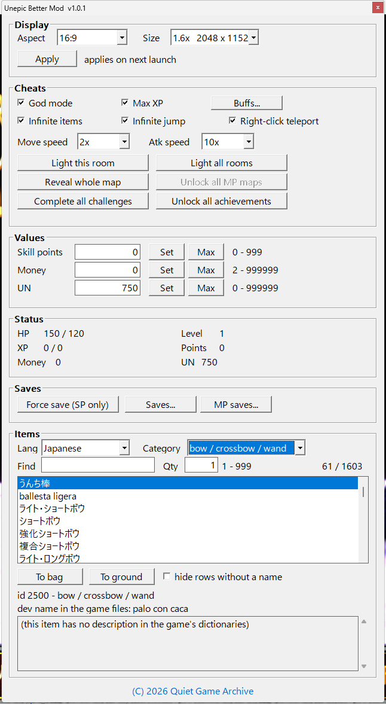

# Unepic Better Mod v1.0.0

A single-player trainer panel for [Unepic](https://store.steampowered.com/app/233980/)
on Steam. It adds a native Windows control panel with cheats, an item catalogue, a
save-slot manager, achievement tools and a few quality-of-life features.

* Built for **Unepic v1.51.1 (build 15101), 32-bit, Steam version**. The mod uses
  fixed addresses inside that executable, so other game builds will not work.
* **Single-player only.** Every feature was tested in a solo game; multiplayer has
  not been tested at all, so do not use the mod in a multiplayer session.
* No network access, no installer beyond one script, no run key, no service, nothing
  that starts at boot. Uninstalling restores the game completely.

Nexus Mods page: https://www.nexusmods.com/unepic/mods/2

## Screenshot

The whole panel, one window, always on top of the game. Press the backquote key to
show or hide it. (This capture has the item language set to Japanese.)



Groups from top to bottom: **Display** (aspect and window size, applied next launch),
**Cheats** (god mode, max XP, infinite items, infinite jump, right-click teleport with an
info button, move/attack speed 1x-10x, the two achievement buttons), **Values** (skill
points, money, UN - each with Set, Max and its valid range), **Status** (live HP, level,
XP, points, money, UN), **Saves** (force save and the save-slot manager), **Items**
(language, category, search, quantity, the catalogue list, to bag / to ground, and the
description box below the selected row).

## Requirements

- **Windows 10 or 11.** Steam itself no longer supports Windows 7, 8 or 8.1, and the C
  runtime the mod links against (the Universal CRT) is part of Windows 10 / 11, so there
  is nothing else to install - no framework, no redistributable, no .NET.
- **Steam version of Unepic, v1.51.1 (build 15101).** Other builds and other stores are
  not supported; the mod reads fixed addresses in that executable.
- Steam running and the game launched through Steam - needed for the achievement
  functions to reach Steam.
- **Windowed mode** (or a desktop-sized borderless window) for the panel to stay visible
  and for the window-size settings; see Installation.
- Do not combine with another mod that replaces the same game file.
- No save backups are made by the mod. Copy a slot before experimenting, and consider
  turning Steam Cloud off so cloud sync cannot overwrite what you just changed.

## Contents

**In the release archive** (what you download): `README.md`, `img/panel.png` (the
screenshot above), and a `mod` folder holding `SDL2.dll`, `unepic_mod_core.dll`,
`items.tsv`, the `unepic_mod.ini` settings template, `dict\` with the 19 language name
tables and 19 description tables, and the two PowerShell scripts.

**In this repository**:

| file | what it is |
|---|---|
| `src/unepic_mod_core.c` | the trainer: hooks, panel, item catalogue, save-slot window, teleport, achievements (4,706 lines of C) |
| `src/unepic_loader.c` | the proxy `SDL2.dll` the game loads: forwards the 14 SDL2 functions, sizes the window before it is created, loads and hot-reloads the core (294 lines) |
| `scripts/install.ps1` | renames the game's `SDL2.dll` to `SDL2_orig.dll`, copies the loader in, copies the settings template |
| `scripts/uninstall.ps1` | restores the original file (checks the hash first so it never deletes somebody else's DLL) |
| `build.ps1` | builds both DLLs from `src/` with the Zig toolchain |
| `data/` | `items.tsv` + the 38 language tables the archive ships + the `unepic_mod.ini` template |
| `tools/build_release.py` | assembles the release archive; the file list in it is the definition of the package (`build` / `check` / `verify`) |

Everything is plain C (C17, clang/GNU dialect) against the Win32 API and the Universal
CRT - no C++, no libraries, no generated code. `data/` is the text the archive ships:
`items.tsv`, the 38 language tables and the settings template. The tables are dumped from
the game's own dictionaries and are what the panel shows when you switch language; they
can also be regenerated in game with the mod's own `[debug] dumpdict` switch.

## Installation

1. Close Unepic.
2. Extract the archive into the game folder - the one containing `unepic.exe`. You
   should end up with a `mod` folder next to the executable.
3. Run `mod\install.ps1` (right-click and choose **Run with PowerShell**; if script
   execution is blocked: `powershell -ExecutionPolicy Bypass -File .\mod\install.ps1`).
4. Start the game and press the **backquote key** (the grave accent / tilde key,
   normally left of the `1` key) to show or hide the panel. It only reacts while the
   game window is in the foreground.

The panel needs the game in **windowed mode** (or a desktop-sized borderless window):
it is an ordinary topmost window, and on an exclusive-fullscreen display it can end up
hidden behind the game. The mod never changes the game's own screen-mode setting.

Updating the mod later is a file copy: replace `mod\unepic_mod_core.dll` while the game
is running and it reloads in about a second. If Steam updates or verifies the game
files, the original `SDL2.dll` comes back and the mod stops loading - run
`install.ps1` again.

Uninstall: close the game, run `mod\uninstall.ps1`, then delete the `mod` folder and
`unepic_mod.ini` if you want. Saves and Steam achievements are not touched.

## What it does

**Cheats** - god mode; max XP (XP kept at the next-level requirement); infinite
consumables; no ammo or durability use for bows, crossbows and wands; infinite jump;
move speed and attack speed 1x to 10x.

**Achievements** - `Complete all challenges` finishes the 15 challenges and pushes their
Steam achievements; `Unlock all achievements` unlocks all 57 (42 logros plus the 15
challenge achievements). Both ask for confirmation, and both call the game's own Steam
API rather than faking anything locally. Achievements cannot be taken back.

**Values** - set skill points (0-999), money (2-999999) and UN (0-999999), with a Max
button and the valid range printed next to each field. Live HP, level, XP, points,
money and UN read-outs.

**Saves** - `Force save` writes through the game's own serializer; `Saves...` opens a
window listing all 16 slots with date, size and the slot in use, copies a slot to
another one, deletes a slot to the Recycle Bin and opens the save folder. The mod does
not keep backups of its own; copy a slot if you want a safety copy.

**Items** - a catalogue of the game's ~1,600 items, filterable by the game's own
categories and by free text, quantity 1-999, send to bag or drop at the player's feet,
with names and descriptions in the game's 19 languages. About 40% of items have
description text in the game's dictionaries; ordinary weapons and armour only ever
show numbers there, so they display a placeholder.

**Right-click teleport** - experimental, off by default. Right-click to move towards
the cursor, horizontal only by default, and one click is limited to 384 world units
because the engine keeps the character near the current room; far targets take several
clicks. `[cheats] tp_scale` in the ini adjusts distance and is re-read on every click.

**Display** - 4:3 / 16:9 / 16:10 and window scale steps, applied on the next launch,
windowed mode only.

## Settings

`unepic_mod.ini` sits next to `unepic.exe` and is created from the shipped template on
install; the mod never overwrites an existing file.

```ini
[video]  resize / aspect / scale / width / height / disable_fso
[cheats] god / maxxp / nocons / nogun / airjump / speed / atkspd
         teleport / tp_scale / tp_mode
[items]  lang / hidenamed
```

Everything except `tp_scale` and `tp_mode` is read at startup, so restart after editing.
`nogun` (ranged weapons do not spend ammo) has no checkbox and defaults to on; the
`!` button next to the teleport checkbox explains the teleport limits in game.

| section | key | default | meaning |
|---|---|---|---|
| video | `resize` | 1 | 0 leaves the game window as the game set it |
| video | `aspect` | 0 | 0 = 4:3, 1 = 16:9, 2 = 16:10 |
| video | `scale` | 20 | tenths of the base size, 10 = 1.0x, capped to the desktop |
| video | `width`, `height` | 0 | optional exact size; both must be non-zero to override |
| video | `disable_fso` | 1 | disable Windows fullscreen optimizations for the game |
| cheats | `god`, `maxxp`, `airjump`, `teleport` | 0 | on / off |
| cheats | `nocons`, `nogun` | 1 | infinite consumables / no ammo or durability use |
| cheats | `speed` | 100 | movement speed percent, 10 - 1000 |
| cheats | `atkspd` | 10 | attack speed in tenths, 10 - 100 |
| cheats | `tp_scale` | 100 | teleport distance correction, percent, 10 - 400 |
| cheats | `tp_mode` | 1 | 1 = horizontal only, 0 = also use the cursor height |
| items | `lang` | en | item name and description language |
| items | `hidenamed` | 0 | hide catalogue rows that have no dictionary name |

## Troubleshooting

- **The panel does not open.** The game has to be the foreground window; press the
  backquote key. `unepic_mod.log` next to `unepic.exe` says what loaded.
- **The game does not start after installing.** Close it, run `mod\uninstall.ps1`,
  verify the game files in Steam, then install again.
- **It stopped working after a game update.** Only v1.51.1 build 15101 is supported;
  uninstall until a version for the new build exists.
- **A save slot is missing or in the wrong place.** The saves window works on the files
  in the Steam userdata folder; reopen the game's load menu after copying or deleting.
- **Achievements do not appear.** Launch through Steam with Steam online. Unlocking is
  permanent - test on an account you do not mind changing.
- **Rows show internal names.** Those items have no entry in the game's own name table;
  switch language or tick `hide rows without a name`.

## Building

Requirements: Windows, and the Zig toolchain (it carries clang/LLVM, the MinGW-w64
headers and the Windows import libraries). Nothing is downloaded. The shipped binaries
were built with Zig 0.17.0; 0.14+ works.

```
.\build.ps1                     # if zig is not on PATH: .\build.ps1 -Zig C:\path\to\zig.exe
.\build.ps1 -Warnings           # adds -Wall -Wextra
.\build.ps1 -Out mybuild        # output folder (default .\build)
.\build.ps1 -HistoricNames      # links the core as unepic_mod_core_new.dll, the name the
                                # release was linked under - use this when comparing
```

The two commands it runs, which is the whole build:

```
zig cc -target x86-windows-gnu -shared -O2 -o unepic_mod_core.dll src/unepic_mod_core.c -luser32 -lgdi32 -limm32 -ladvapi32
zig cc -target x86-windows-gnu -shared -O2 -o SDL2.dll           src/unepic_loader.c   -luser32
```

Diagnostics under `-Wall -Wextra`: two warnings, both known and harmless - an unused
parameter in the core (`edit_int`'s `def`, `src/unepic_mod_core.c:2411`) and an unused
variable in the loader (a leftover `RECT wa;`, `src/unepic_loader.c:100`). Nothing else.
Zig caches compilation output, so re-running the identical command can replay the cached
warnings; rename the output to force a fresh compile.

## Verifying that a build matches the release

Neither the DLLs nor the archive is bit-reproducible, so never compare whole-file hashes:

- LLD writes a randomised PE `TimeDateStamp` and build-ID into every link, and embeds the
  output file name; building in a different folder also moves the string table.
- The zip container stores each file's modification time, so re-packing the same content
  later gives a different archive hash. Compare the files *inside* instead - that is what
  `python -X utf8 tools/build_release.py check` does (entry by entry, md5).

To compare a rebuilt DLL with the one in the release archive, use the section tool:

```
python -X utf8 tools/sect_diff.py build/unepic_mod_core_new.dll <unpacked>/mod/unepic_mod_core.dll
python -X utf8 tools/sect_diff.py build/SDL2.dll                <unpacked>/mod/SDL2.dll
```

It prints a per-section byte-difference table and exits 0 when `.text` is identical.
Measured on the author's machine:

| build | `.text` | `.rdata` | `.data` / `.reloc` / `.tls` | header + `.buildid` |
|---|---|---|---|---|
| `build.ps1 -HistoricNames`, core | 0 bytes differ | 0 differ | 0 differ | 4 (timestamp) + 16 (GUID) |
| `build.ps1`, loader (`SDL2.dll`) | 29 differ | 388 differ | 0 differ | same 4 + 16 |

Not one instruction differs. The 29 + 388 bytes in the loader are the embedded PDB path
string (its length varies with the build directory) and the pointers in `.text` that
point into that string table - read as dwords they are all `0x1003exxx` with a constant
offset. Building the core *without* `-HistoricNames` changes those pointer bytes too
(`.text` 918, `.rdata` 3247) purely because of the embedded name. `-O0` compiles the same
sources to three times the size, confirming the release files are optimised builds.

Shipped hashes:

```
mod/unepic_mod_core.dll  349,184 B  sha256 748665ea15c5880b3166012baef399a6f6e815f15e5bc710d712f3abce8fee09
mod/SDL2.dll             276,480 B  sha256 877531d9a9726f131ca678880d101e44980793566b27eaa276839527ca2ec080
```

```
mod/unepic_mod_core.dll  349,184 B  sha256 748665ea15c5880b3166012baef399a6f6e815f15e5bc710d712f3abce8fee09
mod/SDL2.dll             276,480 B  sha256 877531d9a9726f131ca678880d101e44980793566b27eaa276839527ca2ec080
```

## Why antivirus may flag it

At the time of writing, VirusTotal reports 8 of 68 engines on the release archive, and
all eight are the same BitDefender-based engine family with a generic detection name
(`Gen:Variant.Babar.*`) - no behavioural claim, and Defender, ESET, Kaspersky, Sophos
and Malwarebytes are clean. The reason is structural: Unepic has no scripting interface,
so a mod for it must arrive as a proxy DLL that forwards a library the game already
loads and then patch instructions inside the game process. That is the normal shape of
game modding and also the shape heuristics dislike. Rebuilding with different compiler
flags, adding a version resource or repacking does not change that verdict; the sources
here do.

## Permissions

Use and modify it for personal play however you like; please do not re-upload the
package or modified builds to other sites. Unepic and its assets remain the property of
their authors, and the game's own name/description dictionaries are their content, not
mine. The mod is provided as-is, without warranty.

(C) 2026 Quiet Game Archive
